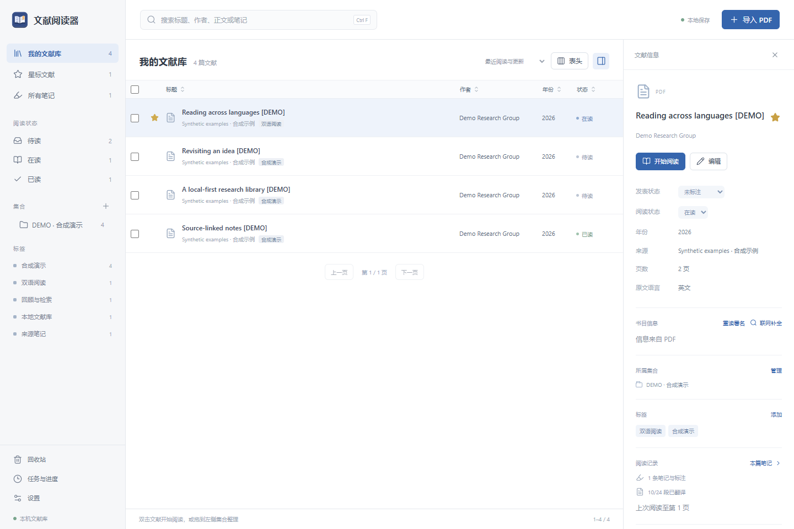
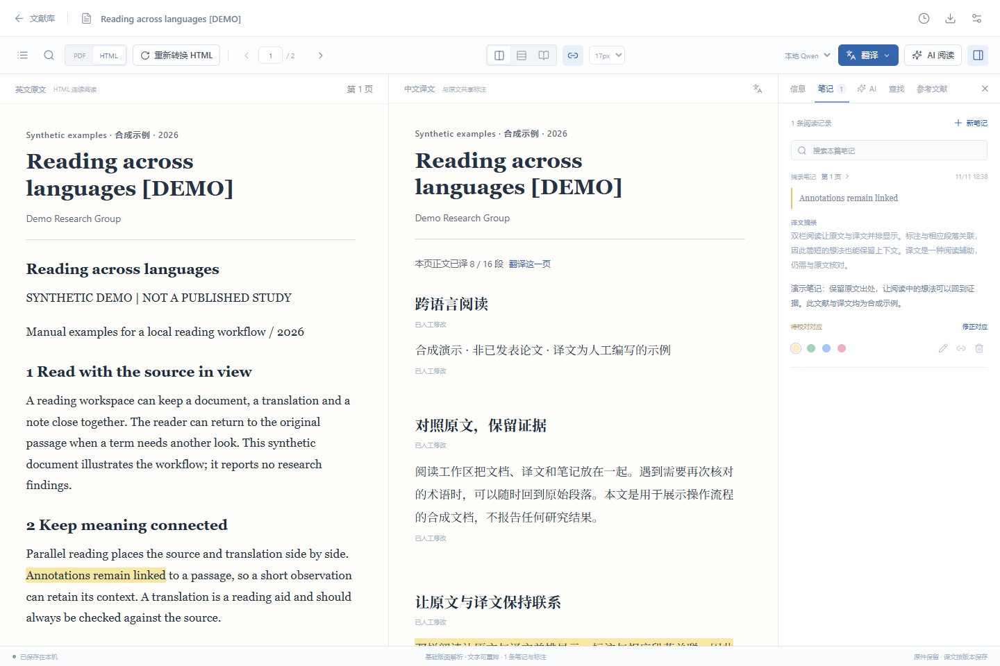
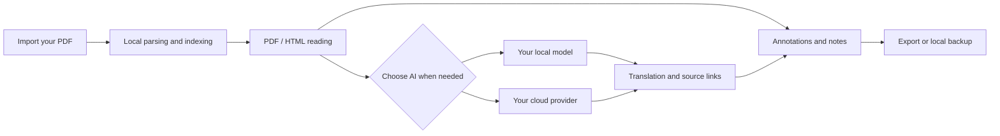

<div align="center">


<p><strong>Your papers, bilingual reading, and research notes, on your own computer.</strong></p>

<p>Original PDF and reflowable text · Chinese–English reading · Source-linked notes · Per-paper AI</p>

<p>
  
  
  
  
  <a href="LICENSE"></a>
</p>

<p>
  <a href="https://github.com/Haowei9226/paper-reader/releases/latest"><strong>Download the latest release</strong></a>
  &nbsp; · &nbsp; <a href="#quick-start">Get started</a>
  &nbsp; · &nbsp; <a href="#features">Features</a>
  &nbsp; · &nbsp; <a href="README.md">简体中文</a>
</p>

</div>

PaperReader is a local literature library and Chinese–English reading tool. Import a PDF, switch between the original and reflowable text, connect highlights and translated passages to their source, and export your notes. For AI features, connect your own local model or choose your own cloud provider.

Menus and settings are currently primarily Chinese, with no English-interface switch. “Bilingual” describes document content and side-by-side reading. Complete documentation is available in both Chinese and English.

**Release packages need no separate Python or Node.js installation. Your first launch starts an empty library, with no distributor API keys, papers, notes, or database.**

> **Platform status:** The Windows x64 executable has been exercised on a real Windows system. The Mac archive contains Apple Silicon and Intel runtimes; its archive, dependencies, and execution permissions have been checked, but **it has not been run on a real Mac**. It is unsigned and not notarized. Scanned-page OCR currently requires Windows.

<a id="whats-new"></a>
## What's new in 0.6.15

- **Follow source footnotes and endnotes.** Confirmed PDF superscripts, internal links, and note positions connect body markers to the Notes sidebar, with jumps to the original note and back to the reading position. Repeated page-local numbers remain separate; uncertain relationships remain unresolved.
- **Read more continuous text.** Column, spacing, indentation, and typography evidence restore paragraphs and lists and join confirmed cross-page continuations, while retaining original page locations and source anchors.
- **Repair characters using PDF evidence.** Reliable glyph and geometry mappings can recover ligatures, accents, and omitted word spaces while preserving mathematical characters and literal hyphens.
- **Protect reading work during HTML rebuilds.** Confirmed mappings migrate translation, annotation, and citation anchors while preserving translation versions and reading locations. Body pages without a safe mapping retain their previous version and are reported in the task result. Previously referenced headers, footers, and short figure labels keep separate retained-source anchors.
- **Separate article credits and page furniture more clearly.** Title, author and affiliation, abstract, publication sidebar, review line number, and repeated header/footer handling reduces interruptions to body text.

Create a local backup before upgrading. To apply the new extraction and layout handling to an existing paper, open it and choose **重新转换 HTML** (Rebuild HTML), then check the result against the PDF. Complex layouts and content without reliable glyph mappings can still require manual review.

<a id="download"></a>
## Download

Visit the [Releases page](https://github.com/Haowei9226/paper-reader/releases/latest) and choose a program package from the release assets. GitHub's automatically generated **Source code (zip / tar.gz)** archives contain source code, not a ready-to-open application.

| Download | Best for | Contents |
| --- | --- | --- |
| [Complete sharing bundle · Windows + Mac](https://github.com/Haowei9226/paper-reader/releases/download/v0.6.15/PaperReader-Share-0.6.15.zip) | First-time use or sharing with colleagues | Both platform archives, instructions, application source, third-party source, and licenses; see the release page for size |
| [Windows x64 package](https://github.com/Haowei9226/paper-reader/releases/download/v0.6.15/PaperReader-Windows-0.6.15.zip) | Windows users | Extract, then run `文献阅读器.exe` |
| [Mac package · both architectures](https://github.com/Haowei9226/paper-reader/releases/download/v0.6.15/PaperReader-macOS-0.6.15.zip) | Apple Silicon or Intel Mac users | Extract, then open `文献阅读器.app`; see the verification limits above |

The complete bundle contains platform ZIPs that must be extracted a second time. Application source and third-party license materials are included in that bundle and are available through this repository and its release page. Preserve them when redistributing the software.

<details>
<summary><strong>Contents</strong></summary>

- [Installation and launch](#quick-start)
- [What's new in 0.6.15](#whats-new)
- [Preview](#preview)
- [Features](#features)
- [A reading workflow](#workflow)
- [AI and network settings](#ai)
- [Data, privacy, and backups](#data)
- [FAQ](#faq)
- [Run from source](#development)
- [Testing and verification limits](#validation)
- [Architecture and packaging](#architecture)
- [License and contributions](#license)

</details>

<a id="quick-start"></a>
## Installation and launch

### Windows 10 / 11 · 64-bit

1. Download and fully extract the Windows package. If using the complete bundle, extract it first, then extract the Windows ZIP inside.
2. Open the extracted folder and double-click **文献阅读器.exe**. Do not run it from the archive preview window.
3. Wait for the local service to start. Your default browser opens the reading interface automatically; the first launch may take several seconds.
4. Drag your own PDFs into the library to start reading, annotating, and exporting. You can create a desktop shortcut to the EXE.

The service listens only on the local loopback interface, usually at `http://127.0.0.1:8767`. If another instance or service occupies a port, the shared build tries nearby ports. Use the address that actually opens in your browser.

### Mac · Apple Silicon and Intel

1. Download the Mac package and extract it using **Finder**. The Mac ZIP inside the complete bundle also needs to be extracted separately.
2. Find **文献阅读器.app** and drag it onto **Applications** in Finder's sidebar.
3. If Applications is not shown in the sidebar, press **Shift + Command + A** to open the folder, then drag the app into it. Enter your Mac login password if the system requests it.
4. Double-click the app in Applications and wait for the reading interface to open in your default browser. No separate Python, Node.js, or Rosetta installation is needed.
5. This version is unsigned and not notarized. If macOS blocks it, verify the download source and follow the system prompt in **System Settings → Privacy & Security** to allow this application. Do not disable system security protections.

The Mac ZIP preserves Unix execution permissions and symbolic links. Extract it directly on a Mac; extracting the `.app` on Windows before transferring it can lose those attributes. Scanned-page OCR is not available on Mac. PDFs with extractable text use the ordinary reading workflow. Actual Mac operation still requires validation.

### Quit and reopen

| What you do | Application state | How to reopen |
| --- | --- | --- |
| Close only the browser tab or window | The local service continues running | Open the same local address; bookmarking it is useful |
| Select **设置 → 退出阅读器** (Settings → Quit Reader) | The service stops; task progress is preserved | Double-click the EXE or the app in Applications again |
| Restart the computer | The reader needs to be started again | Double-click the application; no extraction or installation is needed again |

Papers, notes, and settings live in a separate data directory. Normal shutdown, moving the program folder, or upgrading the application does not automatically clear the library. Make a backup before upgrading.

<a id="preview"></a>
## Preview

### A library you can return to



### Original text, translation, and notes share their sources



*Screenshots use synthetic documents and manually written example translations. They contain no personal papers or real API keys and are not evaluations of AI output. The interface is currently primarily Chinese, without an English-interface switch; documentation is available in Chinese and English.*

<a id="features"></a>
## Features

| Part of your work | What you can do |
| --- | --- |
| **Organize papers** | Batch import and file deduplication; nested collections, tags, stars, and reading status; configurable columns and sorting; trash and restore |
| **Read the source** | Switch between original PDFs and reflowable HTML; use outlines, page navigation, and saved reading positions; search papers, text, existing translations, and notes |
| **Read bilingually** | Side-by-side, alternating-paragraph, and single-language layouts; paragraph-synchronized scrolling; page, chapter, or full-document translation |
| **Link notes to evidence** | View the same annotation across PDF, HTML, and translation; jump from a note to its source; correct cross-language phrase alignments |
| **Continue translation work** | Background tasks, progress, and resume; repair missing passages; preserve manual edits, translation versions, and per-paper terminology |
| **Follow references** | Locate reference entries from citations; open uniquely matched library papers, then return through the citation chain |
| **Follow source notes** | Open confirmed footnotes and endnotes from body markers, jump to the original note, return to the body, and follow recognized references |
| **Ask about one paper** | Structured summaries, selected-passage explanations, and questions; separate conversation history per paper; jump from answer citations to supplied source passages |
| **Handle scans** | Windows system OCR for pages without extractable text; recognized text and geometry stay in the local library, while the original PDF remains unchanged |
| **Export your work** | Annotated PDFs, standalone bilingual HTML, Markdown notes, and CSV / BibTeX / RIS bibliography exports |
| **Back up and migrate** | Local backups, file-hash validation, and restore; preserve the previous library before replacement; exclude API keys and model weights |

<details>
<summary><strong>More about reading, translation, and annotations</strong></summary>

**Reading and navigation.** The HTML view loads nearby pages as needed and supports continuous scrolling. Text split into individual PDF lines is joined into paragraphs using columns, line spacing, and indentation; confirmed paragraphs also continue across page boundaries. Original text and annotation anchors are retained. In-paper search locates matches in original text and existing translations. Outlines, notes, and source-linked AI citations can return to their corresponding passages. PDF / HTML mode and within-page position are saved.

**Complex content.** Geometry and typography distinguish titles, author columns, affiliations, abstracts, copyright, publication sidebars, printed page numbers, and repeated headers and footers. Column continuations, hanging lists, and paragraphs inside one PDF text block are reflowed using layout evidence. Figure labels remain available with the original image and can be expanded or found. Recognized tables support row and cell reading and translation; standalone equations and some graphics retain PDF snapshots. Explicit font evidence can recover ligatures, accents, and omitted word spaces while preserving mathematical Unicode and literal hyphens.

**Conversion limits.** Font and spacing repairs require Rebuild HTML. Source anchors for translations, annotations, and citations migrate using the physical positions of the same PDF glyphs; translated content, version history, and saved reading locations remain intact. Previously referenced headers, footers, and short figure labels remain in a separate retained-source disclosure, allowing the rest of their page to update. They are excluded from further translation and AI reading. Body pages without a provably safe mapping retain their previous version, and the task result reports their count. Missing glyph mappings, complex overlapping layouts, and scans without text cannot be guaranteed to recover automatically. The original PDF remains available; on Windows, scans can use local OCR.

**Translation jobs.** Pause a task or quit and resume later. Batches reuse known terminology for the paper. Sentences split across page boundaries are combined when detected. Retranslation and manual edits create versions; affected alignments are flagged for review. Automatic phrase alignment is a model suggestion that you can correct.

**Bibliographic metadata.** Query Crossref / DataCite using a DOI, arXiv identifier, or title, and generate attachment names from author, year, and title. Manual fields and filenames are preserved. Unpublished manuscripts and internal materials skip automatic lookups; explicitly choosing the single-paper lookup still performs a public search. Automatic lookup is disabled by default in shared builds.

**Citation chains.** Reference matching first uses DOI, then attempts a unique match using full title, first author, and year. After opening a matched library paper, Return to citation restores the previous reading position. External references offer browser links or search entry points.

**Footnotes and endnotes.** Confirmed PDF superscripts, internal links, and note positions connect source markers to the Notes sidebar. From there, jump to the original note, return to the body reading position, or open a recognized reference in the library or browser. Repeated page-local numbers remain separate. Uncertain superscripts and abbreviated references are left unresolved. Complete recognized note blocks appear in a collapsible section in HTML while retaining their source anchors.

</details>

<a id="workflow"></a>
## A reading workflow



The **import → read → annotate → search → export** workflow works without AI configuration. Translation, summaries, and questions require an available model service.

<a id="ai"></a>
## AI and network settings

Choose a provider in **设置 → 模型与翻译** (Settings → Models and Translation) and enter your own configuration. Reading tasks can also select their provider independently. Release packages include neither API keys nor model weights.

| Option | Prepare first | Configure in the reader |
| --- | --- | --- |
| **Local Ollama** | Install and run Ollama yourself, then download a model suitable for your computer | The actual local service URL, commonly `http://127.0.0.1:11434`; the installed model name; an appropriate context length |
| **OpenAI** | Your own working API key and model access | API key and model name; use Test current model to check the connection |
| **DeepSeek** | Your own working API key | API key and model name |

The corresponding `OPENAI_API_KEY` and `DEEPSEEK_API_KEY` environment variables are also supported. Keys entered in Settings use Windows user-scoped encryption or the macOS login Keychain, and are not returned to the interface as plaintext.

### Which actions use the network?

| Action | Data sent or destination accessed |
| --- | --- |
| Local import, reading, notes, search, export, and backup | Processed on your computer; no cloud AI is required |
| Windows local OCR | Uses installed system recognition languages without uploading scanned pages |
| Connected local Ollama | Task content is passed to your configured local model service |
| Explicit cloud AI tasks | Selected original passages, necessary context, relevant terminology, or conversation history are sent to the chosen provider |
| Bibliographic lookup | Identifiers or titles are queried through Crossref / DataCite |
| Opening external references or searching for a paper | The browser visits the corresponding website or search service |

Automatic bibliographic lookup is disabled by default in shared builds. Failed local-model tasks do not automatically switch to a cloud provider. Enable automatic lookup in **设置 → 导入与命名** (Settings → Import and Naming) when wanted. Source-development mode enables lookup by default; disable it in Settings before using an offline workflow.

Review generated translations, summaries, citations, and phrase alignments against the original. Source links help locate evidence; they do not guarantee that a generated statement is correct.

<a id="data"></a>
## Data, privacy, and backups

The interface appears in your browser, while the service binds only to **127.0.0.1**. No reader account or remote server deployment is required. LAN sharing and cloud synchronization are not included.

### Data directories

| Run mode | Default library location |
| --- | --- |
| Windows shared build | `%LOCALAPPDATA%\PaperReader\data` |
| Mac shared build | `~/Library/Application Support/PaperReader/data` |
| Run from source | `data/` inside the project directory |

Use `READER_DATA_DIR` to select another directory for development or isolated testing. Each operating-system user has a separate shared-build library.

| Item | Contents |
| --- | --- |
| `library.sqlite3` | Bibliography, text structure, translation versions, notes, conversations, and job progress |
| `originals/` | Imported PDF copies |
| `assets/` | Extracted images, graphics, and table regions |
| `exports/` / `backups/` | User-generated exports and backups |
| `reader.log` / `jobs.log` | Startup diagnostics and background-job logs |

Settings keys use the current Windows user's DPAPI encryption or the macOS login Keychain. **The library is not an encrypted database as a whole.** Protect your computer and backups according to the sensitivity of your material.

### Back up, restore, and share

1. Create and save a backup in **设置 → 备份与迁移** (Settings → Backup and Migration).
2. Pause active tasks before restoring. The reader validates the manifest, paths, file hashes, and database integrity.
3. The previous library is preserved beside the data directory as `data-before-restore-*` for manual recovery if needed.
4. Backups exclude API keys and local model weights. Configure them again on a new computer.

Share the original Release program archive or complete bundle with colleagues. **Do not share your used data directory, backups, exports, logs, or `.env` files**: they may contain your papers and reading history.

<a id="faq"></a>
## FAQ

<details>
<summary><strong>Do I need an internet connection, an account, or a paid API to open it?</strong></summary>

No. Release packages include the application runtime. Ordinary PDF reading, organization, annotations, search, and exports run locally. You must arrange any initial application, model, or system-language downloads yourself. Cloud AI requires your own provider configuration; provider permissions and charges apply to that service.

</details>

<details>
<summary><strong>Do I have to install the Mac application again after closing it?</strong></summary>

No. After quitting through Settings → Quit Reader, double-click the app in Applications again. Closing only the browser leaves the service running; reopen the same local address. Your papers and notes stay in the user data directory.

</details>

<details>
<summary><strong>The browser does not open, or the reader says an older version is still running.</strong></summary>

Check `reader.log` in the data directory for the startup address. It is usually `http://127.0.0.1:8767`; a shared build may choose a nearby port when necessary. If an older version is running, quit its service through its Settings page before opening the new version. Include only necessary, redacted error excerpts in an issue report.

</details>

<details>
<summary><strong>I can see a scanned PDF, but cannot select its text.</strong></summary>

On Windows, use Local OCR and install the required OCR language through Windows language settings. Only pages without extractable text are recognized. Mac currently has no scanned-page OCR. You can first create a PDF text layer with another local tool, then import the result.

</details>

<details>
<summary><strong>My download contains code rather than an application.</strong></summary>

Download `PaperReader-Share-*.zip` or the matching platform ZIP from the release assets. GitHub's automatic Source code downloads are intended for developers and do not include the built frontend or a double-clickable program.

</details>

<details>
<summary><strong>Does it cover an entire research workflow?</strong></summary>

The current focus is local PDF reading and research notes. Handwriting, multi-paper AI comparison, multiple attachments per item, Word / WPS integration, and cloud synchronization are not included. PDF annotations added in other readers do not automatically sync back. Check complex columns, tables spanning pages, equations, and missing characters against the original PDF.

</details>

<a id="development"></a>
## Run from source

Use a release package for ordinary reading. The following steps are for development, using **Python 3.12 and Node.js 22**. Installing dependencies requires internet access. This repository excludes virtual environments, `node_modules`, build output, and personal data.

<details>
<summary><strong>Windows · PowerShell</strong></summary>

```powershell
git clone https://github.com/Haowei9226/paper-reader.git
cd paper-reader

py -3.12 -m venv .venv
.\.venv\Scripts\python.exe -m pip install -r requirements.lock

cd web
npm.cmd ci
npm.cmd run build
cd ..

.\.venv\Scripts\python.exe -B -m reader
```

After installing Python and Node.js, `Setup.cmd` is another option for dependency installation, frontend building, and shortcut creation. Use `Start-Reader.cmd` for console startup diagnostics.

</details>

<details>
<summary><strong>macOS · Terminal</strong></summary>

```bash
git clone https://github.com/Haowei9226/paper-reader.git
cd paper-reader

python3.12 -m venv .venv
.venv/bin/python -m pip install -r requirements.lock

cd web
npm ci
npm run build
cd ..

.venv/bin/python -B -m reader
```

Source mode stores its library under the project's `data/` directory and enables automatic bibliographic lookup by default. Disable lookup in Settings for an offline reading workflow. Never commit your data directory or credential files to Git.

</details>

### Development checks

Backend tests use synthetic documents and isolated libraries. Do not point them at your real library.

```bash
python -m pip install pytest
python -m pytest -q --basetemp output/pytest-data
```

Here, `python` means the virtual-environment interpreter with the dependencies installed. To check and build the frontend:

```bash
cd web
npm run typecheck
npm run build
```

To use a separate backend port, run `python -m reader --no-browser --port 18767`. Run `npm run dev` inside `web/` only when frontend hot reload is needed.

<a id="validation"></a>
## Testing and verification limits

| Completed check | What it establishes | What it does not establish |
| --- | --- | --- |
| Backend regressions, frontend type checking, and production build | Covered library, note, translation-job, backup, and API behavior passes the checks | Every real-paper layout, long-term operation, or compatibility with every machine |
| Actual Windows EXE exercise | With a system-tools-only PATH, a separate empty profile, and no API configuration: startup, real background parsing of a synthetic PDF, notes, PDF / HTML / Markdown exports, and persistence after a clean restart | Exhaustive compatibility with different hardware, enterprise policies, or antivirus products |
| Mac archive inspection | Both architectures' runtimes, dependencies, execution bits, symbolic links, and resources are present and checked | Real Mac startup, Keychain interaction, or reading behavior |
| Release privacy and integrity checks | Reviewed archives exclude configured credentials, personal PDFs, the original library, and logs; archive contents and checksums agree | Any guarantee about data subsequently added by a user |

AI output still needs human review. Public metadata coverage is incomplete; Chinese papers, unindexed material, and items without reliable identifiers may require manual editing. Demonstration screenshots are not evidence of translation quality or model accuracy.

<a id="architecture"></a>
## Architecture and packaging

| Layer | Technology |
| --- | --- |
| Browser interface | React, TypeScript, Vite, PDF.js |
| Local service | FastAPI, Uvicorn, background worker processes |
| Document processing | PyMuPDF, text geometry and layout processing, Windows system OCR |
| Persistence | SQLite, full-text search, local files, and backups |
| Model connections | Local Ollama, OpenAI, DeepSeek |
| Release distribution | Windows PyInstaller executable; dual-architecture Mac Python runtimes and platform dependencies |

```text
reader/             Local service, parsing, search, AI, notes, and backups
web/src/            React reading and library interface
scripts/            Packaging, launch resources, and executable checks
tests/              Synthetic data and regression tests
assets/             Application icon
docs/               Sharing instructions and demonstration images
```

Packaging scripts collect application resources through an allowlist and exclude personal libraries and credentials:

- `scripts/package_common.py`: instructions, application source, third-party source, and licenses.
- `scripts/package_windows.py`: Windows x64 executable and program archive; build it on Windows.
- `scripts/package_macos.py`: download and verify pinned public Python runtimes, combine dependencies for both architectures, and preserve Unix attributes.
- `scripts/package_share.py`: combine both platform ZIPs with one copy of the common materials.
- `scripts/smoke_windows_package.py`: exercise an actual Windows executable with a synthetic empty-library workflow.

Rebuilding requires a built frontend, a clean packaging environment, and the matching third-party source archives. See `REBUILD.txt` inside the complete bundle's `Source.zip`. Cross-platform assembly does not replace execution tests on the target operating system.

<a id="license"></a>
## License and contributions

This version of the PaperReader application is provided under **GNU AGPL v3**; see [LICENSE](LICENSE). PyMuPDF / MuPDF and other third-party software retain their own licenses and notices. The [complete sharing bundle](https://github.com/Haowei9226/paper-reader/releases/download/v0.6.15/PaperReader-Share-0.6.15.zip) includes application source, corresponding PDF-engine source, and license materials.

Use [Issues](https://github.com/Haowei9226/paper-reader/issues) for reproducible bugs or feature suggestions. Include the operating-system version, application version, steps, and redacted error details. Do not upload API keys, private papers, an entire database, or unreviewed logs. A minimal synthetic PDF that you can share publicly is often useful for reproducing layout problems.

<div align="center">

**Start with a PDF. Keep your reading work in your own library.**

[Download the latest release](https://github.com/Haowei9226/paper-reader/releases/latest) · [中文文档](README.md)

</div>
