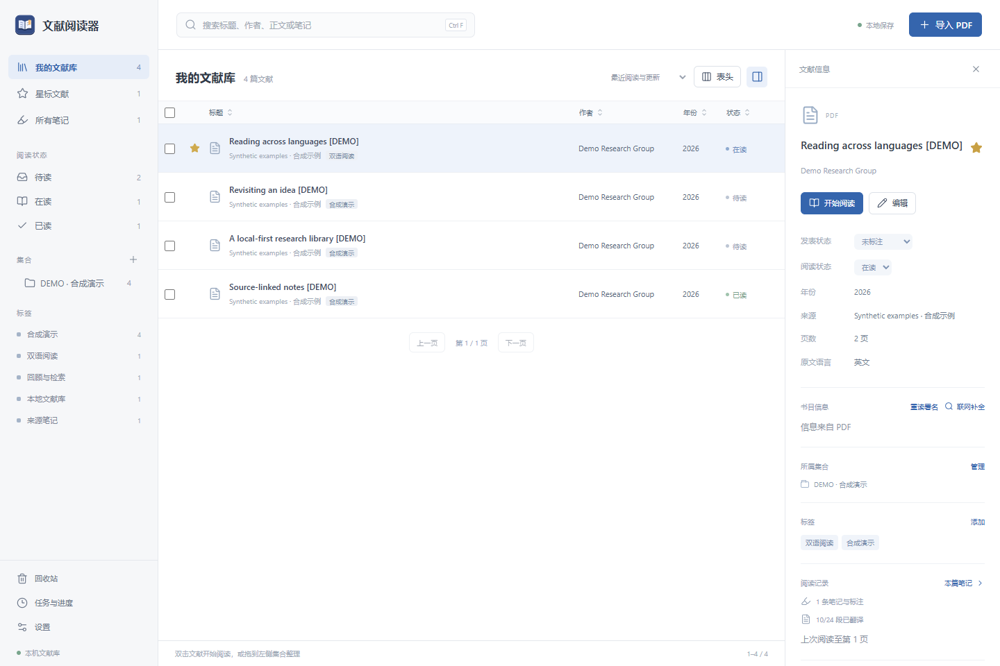
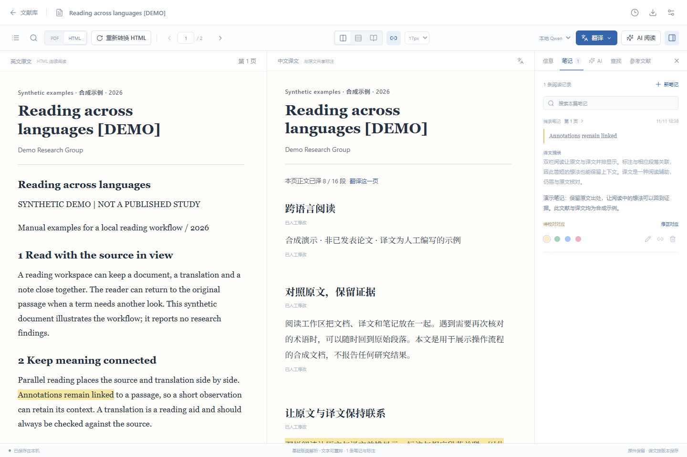
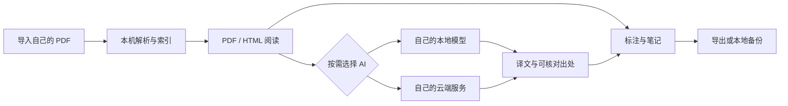

<div align="center">


<p><strong>把文献、双语阅读和研究笔记，放回自己的电脑。</strong></p>

<p>PDF 原件与可重排正文 · 中英对照 · 来源标注 · 按篇 AI 助手</p>

<p>
  
  
  
  
  <a href="LICENSE"></a>
</p>

<p>
  <a href="https://github.com/Haowei9226/paper-reader/releases/latest"><strong>下载最新版本</strong></a>
  &nbsp; · &nbsp; <a href="#quick-start">安装与启动</a>
  &nbsp; · &nbsp; <a href="#features">功能一览</a>
  &nbsp; · &nbsp; <a href="README.en.md">English</a>
</p>

</div>

PaperReader 是一个在本机运行的文献管理与中英双语阅读器。拖入 PDF，在原件和可重排正文之间切换，把高亮、批注、译文与原文位置连起来，再导出阅读成果。需要 AI 时，连接自己的本地模型，或选择自己的云端服务。

菜单与设置目前以中文为主，尚未提供英语界面切换；这里的「中英双语」指文献内容与对照阅读。使用文档提供完整中英文版本。

**成品包无需安装 Python 或 Node.js。首次打开是空文献库，不包含分享者的 API 密钥、论文、笔记或数据库。**

> **平台状态：** Windows x64 成品已完成实际运行验证。Mac 包包含 Apple 芯片和 Intel 两套运行环境，已检查归档、依赖与执行权限，**尚未经真实 Mac 运行验证**，也未签名或公证。扫描件 OCR 目前仅支持 Windows。

<a id="whats-new"></a>
## 0.6.15 更新

- **脚注与尾注可以回到出处。** 根据 PDF 上标、内部链接与注释位置识别注号，在正文和「注释」侧栏之间跳转，并返回原阅读位置。页内重复编号分别处理，无法确认的关系保留为未匹配。
- **正文阅读更连贯。** 根据列、行距、缩进与字体恢复段落和列表，衔接能确认的跨页续文，同时保留原页码与来源锚点。
- **字符修复依靠 PDF 证据。** 有可靠字形和几何映射时，修复连字、重音和缺失词距；保留数学字符与真实连字符。
- **重新转换保护已有阅读成果。** 迁移能确认的译文、批注和引用定位，保留译文版本与阅读位置；无法安全映射的正文页沿用旧版，并在任务结果中说明。已被引用的旧页眉、页脚或图内短标签单独保留出处。
- **文首与页边内容分得更清楚。** 改进题名、作者与单位、摘要、出版侧栏、审稿行号及重复页眉页脚的识别，减少它们打断正文的情况。

升级前建议先创建本地备份。要让已有文献使用新版文字提取与版面处理，打开文献后点击 **重新转换 HTML**，再对照 PDF 核对结果；复杂版式和缺少可靠字形映射的内容仍可能需要人工检查。

<a id="download"></a>
## 下载

请打开 [Releases 下载页](https://github.com/Haowei9226/paper-reader/releases/latest)，选择发布资产中的程序包。页面底部自动生成的 **Source code (zip / tar.gz)** 是源码，不能直接双击运行。

| 下载项 | 适合谁 | 包内内容 |
| --- | --- | --- |
| [完整分享包 · Windows + Mac](https://github.com/Haowei9226/paper-reader/releases/download/v0.6.15/PaperReader-Share-0.6.15.zip) | 首次使用，或转发给同事 | 两个平台包、使用说明、应用源码、第三方源码和许可；大小见发布页 |
| [Windows x64 程序包](https://github.com/Haowei9226/paper-reader/releases/download/v0.6.15/PaperReader-Windows-0.6.15.zip) | 只需要 Windows 程序 | 解压后运行「文献阅读器.exe」 |
| [Mac 双架构程序包](https://github.com/Haowei9226/paper-reader/releases/download/v0.6.15/PaperReader-macOS-0.6.15.zip) | Apple 芯片或 Intel Mac | 解压后打开「文献阅读器.app」；请留意上方验证范围 |

完整分享包内的平台 ZIP 还需要再解压一次。完整源码与第三方许可随总包提供，也可从本仓库及发布页获取；再分发时请保留这些材料。

<details>
<summary><strong>查看目录</strong></summary>

- [安装与启动](#quick-start)
- [0.6.15 更新](#whats-new)
- [界面预览](#preview)
- [功能一览](#features)
- [一次阅读如何完成](#workflow)
- [AI 与联网设置](#ai)
- [数据、隐私与备份](#data)
- [常见问题](#faq)
- [从源码运行](#development)
- [测试与验证范围](#validation)
- [技术结构与打包](#architecture)
- [许可与参与](#license)

</details>

<a id="quick-start"></a>
## 安装与启动

### Windows 10 / 11 · 64 位

1. 下载并完整解压 Windows 程序包。若下载的是完整分享包，先解压总包，再解压里面的 Windows ZIP。
2. 打开解压后的文件夹，双击 **文献阅读器.exe**。不要在压缩包预览窗口内直接运行。
3. 等待程序在本机启动，默认浏览器会自动打开阅读界面。第一次启动可能需要十几秒。
4. 将自己的 PDF 拖进文献库，即可开始阅读、做笔记和导出。可以为 EXE 创建桌面快捷方式。

阅读器仅监听本机回环地址，通常为 `http://127.0.0.1:8767`。分享版遇到其他实例或端口占用时，会尝试附近的空闲端口；请以自动打开的实际地址为准。

### Mac · Apple 芯片与 Intel

1. 下载 Mac 程序包，用 **Finder（访达）** 解压。完整分享包中的 Mac ZIP 也需要单独解压。
2. 找到 **文献阅读器.app**，把它拖到 Finder 左侧的 **应用程序**。
3. 如果左侧没有「应用程序」，按 **Shift + Command + A** 打开该文件夹，再拖入 App。需要时按系统提示输入 Mac 登录密码。
4. 在「应用程序」里双击 App，等待默认浏览器打开阅读界面。无需另外安装 Python、Node.js 或 Rosetta。
5. 本版未签名、公证。如果 macOS 阻止打开，在确认下载来源后，按系统提示到 **系统设置 → 隐私与安全性** 允许本次打开；无需关闭系统安全保护。

Mac 包保留了 Unix 执行权限和符号链接。请直接在 Mac 上解压，避免先在 Windows 上解压 `.app` 再传过去。暂不支持 Mac 扫描件 OCR；带可提取文字的 PDF 可使用普通阅读流程。Mac 实际运行仍待验证。

### 退出与再次打开

| 你做了什么 | 程序状态 | 下次怎么打开 |
| --- | --- | --- |
| 只关闭浏览器标签页或窗口 | 本机服务仍在后台运行 | 打开先前的本地地址；建议把它加入书签 |
| 点击「设置 → 退出阅读器」 | 服务退出，任务保留进度 | 再次双击 EXE 或「应用程序」里的 App |
| 重新启动电脑 | 需要重新启动阅读器 | 再次双击程序，无需重新解压或安装 |

论文、笔记和设置保存在独立的数据目录里。正常退出、移动程序文件夹或升级程序，不会自动清空文献库。更新前仍建议先做一份备份。

<a id="preview"></a>
## 界面预览

### 把文献整理成可继续阅读的工作台



### 原文、译文和笔记共用出处



*展示图使用合成文档与人工编写的示例译文，不包含个人论文或真实 API 密钥，不代表 AI 效果评测。应用界面目前以中文为主，尚无英语界面切换；本仓库同时提供中英文使用文档。*

<a id="features"></a>
## 功能一览

| 工作环节 | 你可以做什么 |
| --- | --- |
| **整理文献** | 批量导入与文件去重；层级集合、标签、星标和阅读状态；自定义列表列与排序；回收站恢复 |
| **阅读原文** | PDF 原件与可重排 HTML 切换；目录、页码和阅读位置恢复；正文、译文、文献信息及笔记搜索 |
| **双语对照** | 左右对照、段落交替或单语阅读；按段同步滚动；当前页、章节或全文翻译 |
| **来源标注** | 在 PDF、HTML 和译文中查看同一条批注；从笔记跳回原文；修正跨语言短语对应 |
| **连续翻译** | 后台任务、进度与续译；缺失段落补译；保留人工修改、译文版本和按篇术语 |
| **参考文献导航** | 从正文引用定位参考条目；唯一匹配的库内文献可直接打开，再逐篇返回引用处 |
| **原文脚注与尾注** | 从能确认的正文注号打开原文注释，跳到注释所在页并返回正文；识别到的文献可继续跳转 |
| **按篇 AI 阅读** | 结构化摘要、选段解释和文献问答；每篇独立对话；从回答出处跳回提供的原文 |
| **扫描件处理** | Windows 系统 OCR 识别无文字页，将文字与坐标存入本地文献库，原 PDF 保持原样 |
| **带走阅读成果** | 带高亮和批注的 PDF、独立双语 HTML、Markdown 笔记，以及 CSV / BibTeX / RIS 书目 |
| **备份与迁移** | 本地备份、文件哈希校验和恢复；恢复前保留原文献库；密钥与模型权重不进入备份 |

<details>
<summary><strong>展开阅读、翻译与标注细节</strong></summary>

**阅读与定位。** HTML 正文按需加载附近页面，可连续滚动。PDF 中拆成单行的正文按列、行距和缩进接回段落，确认连续的跨页段落也会衔接；原始文字与标注锚点保留。文献内查找会标出原文与已有译文的命中位置，目录、笔记和可核对的 AI 出处都可跳回对应段落。阅读器会保存 PDF / HTML 模式及页内位置。

**复杂内容。** 根据几何和字体区分题名、多列作者、单位、摘要、版权、出版侧栏、印刷页码和重复页眉页脚。双栏续句、悬挂列表和同一 PDF 文本块中的段落按版面证据重排；图内文字随原图保留，可展开查找。表格可按识别到的行列阅读和翻译，独立公式与部分图形保留 PDF 截图。字体明确声明的连字、重音和缺失词距会尝试恢复，数学 Unicode 和真实连字符保留。

**转换边界。** 字体与词距修复需点击「重新转换 HTML」。重新提取时，根据同一 PDF 字形的物理位置迁移译文、批注和引用的原文定位，保留译文内容、历史版本和阅读位置。曾被引用的旧页眉、页脚或短图内标签会单独收入「保留的原文定位」，不阻止整页正文更新，也不再加入翻译或 AI 阅读。无法证明安全映射的正文仍保留原页，任务结果会说明保留页数。没有可靠字形映射的乱码、复杂叠排和无文本扫描件不能保证自动准确恢复，仍可随时核对 PDF 原件；Windows 上的扫描件可使用本地 OCR。

**翻译任务。** 任务可以暂停、退出后继续；分批处理时沿用本篇已有术语。检测到被分页截断的句子时，会尝试跨页合并翻译。重新翻译或人工编辑创建新版本，受影响的短语对应会提示校对。自动对应是模型建议，可由使用者修正。

**书目信息。** 可使用 DOI、arXiv 编号或标题查询 Crossref / DataCite，并生成基于作者、年份和标题的附件名。手动字段和附件名会保留。未发表手稿和内部资料跳过自动联网查询；主动点击单篇「联网补全」仍会进行公开检索。分享版默认关闭自动联网补全。

**引用链。** 参考条目优先按 DOI 匹配库内文献，没有 DOI 时尝试完整标题、首位作者和年份的唯一匹配。打开库内文献后，「返回引用处」可恢复上一份文献的位置；库外条目提供浏览器链接或检索入口。

**脚注与尾注。** 根据原始 PDF 的上标、内部链接和注释位置识别注号，点击 PDF 或 HTML 正文中的注号可打开「注释」侧栏，并跳到原始注释、返回正文阅读位置。注释中识别到的文献沿用库内匹配和浏览器入口；普通说明保留文字。页内重复编号分别定位，无法确认的上标和简写引用不会强行匹配。HTML 中完整识别的注释收在「本页注释」中，保留原文位置。

</details>

<a id="workflow"></a>
## 一次阅读如何完成



没有 AI 配置也能完成 **导入 → 阅读 → 标注 → 搜索 → 导出**。AI 翻译、摘要和问答需要一个可用的模型服务。

<a id="ai"></a>
## AI 与联网设置

在 **设置 → 模型与翻译** 中选择服务，填写自己的配置；阅读任务也可单独选择服务。分享包不附带 API 密钥或模型权重。

| 使用方式 | 需要准备 | 阅读器中填写 |
| --- | --- | --- |
| **本地 Ollama** | 自行安装并运行 Ollama，下载一个适合本机的模型 | 实际服务地址（常见为 `http://127.0.0.1:11434`）、已下载的模型名称和合适的上下文长度 |
| **OpenAI** | 自己的可用 API Key 与模型权限 | API Key 和模型名称；可以使用「测试当前模型」检查连接 |
| **DeepSeek** | 自己的可用 API Key | API Key 和模型名称 |

程序支持通过 `OPENAI_API_KEY`、`DEEPSEEK_API_KEY` 环境变量提供对应密钥。在设置页填写的密钥使用 Windows 用户加密或 macOS 登录钥匙串保存，不会原样返回给界面。

### 哪些操作会联网？

| 操作 | 发送或访问的内容 |
| --- | --- |
| 本地导入、阅读、笔记、搜索、导出与备份 | 在本机处理，不要求云端 AI |
| Windows 本地 OCR | 使用系统已安装的识别语言，不上传扫描页 |
| 已连接的本机 Ollama | 将任务内容交给所配置的本机模型服务 |
| 主动使用云端 AI | 将选定范围的原文、必要上下文、相关术语或对话发送给所选服务 |
| 联网补全书目 | 向 Crossref / DataCite 查询标识符或标题 |
| 打开外部参考链接或搜索文献 | 在浏览器访问对应网站或搜索服务 |

分享版默认关闭自动书目查询，本地模型任务失败也不会自动切换到云端。需要自动补全时，可以在 **设置 → 导入与命名** 中开启。源码开发模式默认开启书目查询，离线使用前请先在设置里关闭。

生成的翻译、摘要、引用与短语对应需要结合原文核对；出处链接帮助定位原文，不能保证生成内容一定正确。

<a id="data"></a>
## 数据、隐私与备份

程序界面在浏览器中显示，服务只绑定 **127.0.0.1**。无需注册阅读器账户，也无需部署远程服务器；当前没有局域网共享或云同步。

### 数据目录

| 运行方式 | 默认文献库位置 |
| --- | --- |
| Windows 分享版 | `%LOCALAPPDATA%\PaperReader\data` |
| Mac 分享版 | `~/Library/Application Support/PaperReader/data` |
| 从源码运行 | 项目目录下的 `data/` |

开发或隔离测试时可使用 `READER_DATA_DIR` 指定另一目录。不同系统用户拥有各自的分享版文献库。

| 数据项 | 内容 |
| --- | --- |
| `library.sqlite3` | 书目、正文结构、译文版本、笔记、对话与任务进度 |
| `originals/` | 导入的原始 PDF 副本 |
| `assets/` | 提取图片、图形及表格区域 |
| `exports/` / `backups/` | 使用者生成的导出与备份 |
| `reader.log` / `jobs.log` | 启动诊断与后台任务日志 |

Windows 设置页保存的密钥由当前用户的 DPAPI 加密，Mac 密钥存入登录钥匙串。**文献库本身并非整体加密数据库**；请按自己的资料敏感程度保护电脑和备份。

### 备份、恢复与分享

1. 在 **设置 → 备份与迁移** 创建并保存备份。
2. 恢复前暂停处理任务，选择备份文件。恢复会校验清单、路径、文件哈希和数据库完整性。
3. 成功恢复前的文献库保留为相邻的 `data-before-restore-*` 目录，可用于人工回退。
4. API 密钥和本地模型权重不包含在备份里，换电脑后需要重新配置。

给同事转发原始 Release 程序包或完整分享包即可。**不要转发自己使用后的数据目录、备份、导出、日志或 `.env` 文件**；它们可能包含自己的文献和阅读记录。

<a id="faq"></a>
## 常见问题

<details>
<summary><strong>需要联网、注册或付费 API 才能打开吗？</strong></summary>

不需要。成品包自带程序运行环境，普通 PDF 阅读、管理、标注、搜索和导出可以在本机完成。需要下载程序、模型或系统语言包时，要自行完成相应下载；云端 AI 任务需要自己的服务配置，费用与权限由所选服务决定。

</details>

<details>
<summary><strong>Mac 关闭后，下次还要安装吗？</strong></summary>

不用。用「设置 → 退出阅读器」退出后，下次在「应用程序」里再次双击 App。只关浏览器时，服务仍在运行，重新打开先前的本地地址即可。文献与笔记保存在用户数据目录中。

</details>

<details>
<summary><strong>浏览器没有自动打开，或者提示旧版仍在运行？</strong></summary>

先查看数据目录中的 `reader.log`，确认服务启动地址。默认地址通常是 `http://127.0.0.1:8767`，端口冲突时分享版可能使用附近端口。若提示旧版仍在运行，先从旧界面的设置退出旧服务，再打开新版本。向项目提交问题时，只提供必要且已脱敏的错误片段。

</details>

<details>
<summary><strong>扫描 PDF 看得到，却选不到字？</strong></summary>

Windows 上可以使用「本地 OCR」，并在系统语言设置中安装所需的 OCR 语言包。OCR 只识别没有可提取文字的页面。Mac 版目前没有扫描件 OCR；可以先用其他本地工具生成带文字层的 PDF，再导入阅读器。

</details>

<details>
<summary><strong>下载之后打开的是代码，而不是程序？</strong></summary>

请到 Releases 的资产列表下载 `PaperReader-Share-*.zip` 或对应平台程序 ZIP。GitHub 自动提供的 `Source code` 是给开发者的源码，不包含构建后的前端或可双击程序。

</details>

<details>
<summary><strong>能替代完整的科研工作流吗？</strong></summary>

当前侧重本机 PDF 阅读与研究笔记。手写标注、多篇 AI 比较、一个条目的多个附件、Word / WPS 插件及云同步尚未包含。其他阅读器新增的 PDF 批注不会自动回流。复杂双栏、跨页表格、公式和缺失字符仍应与原件核对。

</details>

<a id="development"></a>
## 从源码运行

普通使用者请优先下载成品包。以下步骤面向开发者，建议使用 **Python 3.12 与 Node.js 22**；安装依赖需要联网。仓库不包含虚拟环境、`node_modules`、构建产物或个人数据。

<details>
<summary><strong>Windows · PowerShell</strong></summary>

```powershell
git clone https://github.com/Haowei9226/paper-reader.git
cd paper-reader

py -3.12 -m venv .venv
.\.venv\Scripts\python.exe -m pip install -r requirements.lock

cd web
npm.cmd ci
npm.cmd run build
cd ..

.\.venv\Scripts\python.exe -B -m reader
```

也可在安装 Python 与 Node.js 后使用 `Setup.cmd` 完成依赖安装、前端构建和快捷方式创建，使用 `Start-Reader.cmd` 进行控制台启动诊断。

</details>

<details>
<summary><strong>macOS · Terminal</strong></summary>

```bash
git clone https://github.com/Haowei9226/paper-reader.git
cd paper-reader

python3.12 -m venv .venv
.venv/bin/python -m pip install -r requirements.lock

cd web
npm ci
npm run build
cd ..

.venv/bin/python -B -m reader
```

源码模式的数据默认保存在本项目的 `data/`，并默认开启导入时的书目查询。需要完全本地的阅读流程时，先在设置里关闭自动联网补全；不要把自己的 `data/` 或密钥文件提交到 Git。

</details>

### 开发检查

后端测试使用合成文献与隔离文献库，不应指向自己的正式数据目录。

```bash
python -m pip install pytest
python -m pytest -q --basetemp output/pytest-data
```

上面的 `python` 应为已安装依赖的虚拟环境解释器。前端检查与生产构建：

```bash
cd web
npm run typecheck
npm run build
```

可以为后端指定独立端口：`python -m reader --no-browser --port 18767`。仅在需要前端热更新时运行 `web/` 中的 `npm run dev`。

<a id="validation"></a>
## 测试与验证范围

| 已完成的检查 | 能说明什么 | 不能代替什么 |
| --- | --- | --- |
| 后端回归测试、前端类型检查和生产构建 | 已覆盖的文献、笔记、翻译任务、备份与接口行为通过检查 | 所有真实论文版式、长期运行和全部机器兼容性 |
| Windows 实际 EXE 测试 | 在仅含系统工具的 PATH、独立空库且无 API 配置时，能启动、真实后台解析合成 PDF、保存笔记、导出 PDF / HTML / Markdown，退出重启后保留数据 | 不同 Windows 硬件、企业策略或杀毒软件的全面兼容性 |
| Mac 归档检查 | 两种芯片的运行环境、依赖、执行位、符号链接与资源完整性已核对 | 真实 Mac 启动、钥匙串交互或实际阅读验证 |
| 发布包隐私与完整性检查 | 所审核文件不包含配置密钥、个人 PDF、原文献库、日志等；归档和校验值一致 | 对未来使用者加入的数据作保证 |

AI 结果仍需人工核对。公开书目覆盖不完整，中文文献、未收录资料或缺少可靠标识符的条目可能需要手动编辑。截图中的示例内容不构成翻译质量或模型准确性证明。

<a id="architecture"></a>
## 技术结构与打包

| 层 | 技术 |
| --- | --- |
| 浏览器界面 | React、TypeScript、Vite、PDF.js |
| 本机服务 | FastAPI、Uvicorn、后台任务进程 |
| 文献处理 | PyMuPDF、文字坐标与版面处理、Windows 系统 OCR |
| 持久数据 | SQLite、全文检索、本地文件与备份 |
| 模型连接 | 本机 Ollama、OpenAI、DeepSeek |
| 分享版 | Windows PyInstaller 可执行文件；Mac 双架构 Python 运行环境与平台依赖 |

```text
reader/             本机服务、解析、检索、AI、笔记与备份
web/src/            React 阅读与文献管理界面
scripts/            打包、启动资源与成品验证脚本
tests/              合成数据与回归测试
assets/             程序图标
docs/               分享说明与演示图片
```

发布脚本按白名单收集程序资源，不打包个人库或密钥：

- `scripts/package_common.py`：使用说明、应用源码、第三方源码及许可。
- `scripts/package_windows.py`：Windows x64 EXE 和程序 ZIP，需在 Windows 构建。
- `scripts/package_macos.py`：下载并校验指定版本的公开 Python 运行环境，组合两种芯片的依赖，保留 Unix 属性。
- `scripts/package_share.py`：把两个平台 ZIP 与一份公共材料组合成完整分享包。
- `scripts/smoke_windows_package.py`：针对实际 Windows EXE 的合成空库检查。

重建前需要先构建前端、准备干净的打包环境，以及对应版本的第三方源码。完整分享包中 `Source.zip` 的 `REBUILD.txt` 提供重建说明。跨平台组装并不等于在相应系统上验证运行。

<a id="license"></a>
## 许可与参与

PaperReader 的本版应用代码按 **GNU AGPL v3** 提供，见 [LICENSE](LICENSE)。PyMuPDF / MuPDF 及其他第三方软件保留各自的许可和声明；[完整分享包](https://github.com/Haowei9226/paper-reader/releases/download/v0.6.15/PaperReader-Share-0.6.15.zip)附应用源码、对应 PDF 引擎源码与许可材料。

欢迎通过 [Issues](https://github.com/Haowei9226/paper-reader/issues) 提交可复现的问题或功能建议。请附系统版本、程序版本、操作步骤及已脱敏的错误信息；不要上传 API 密钥、私人论文、整个数据库或未清理的日志。可公开分享的最小合成 PDF 样例通常更方便复现排版问题。

<div align="center">

**从一篇 PDF 开始，把阅读痕迹留在自己的文献库里。**

[下载最新版本](https://github.com/Haowei9226/paper-reader/releases/latest) · [English documentation](README.en.md)

</div>
